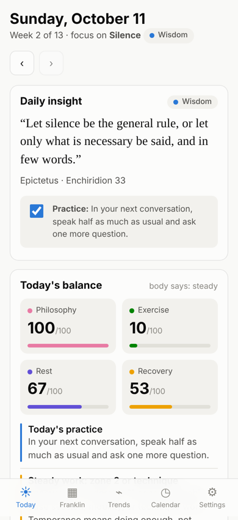
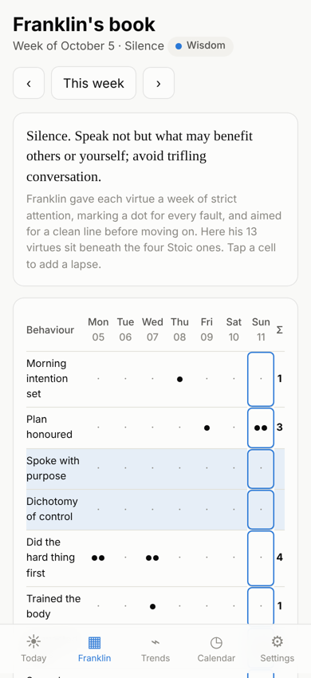
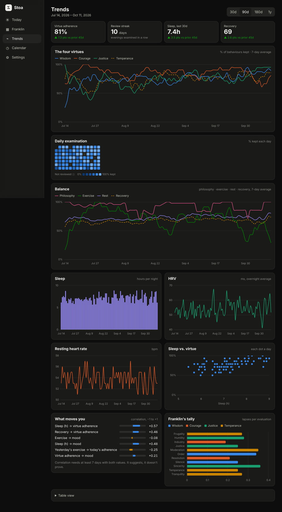

# Stoa

A personal web app for a daily Stoic practice. It combines Benjamin Franklin's
self-examination method with your Garmin health data and your Google Calendar,
and charts how you change over time. It runs in Safari on your iPhone (added to
the Home Screen, it opens like an app) and in any browser on your Mac. Both read
the same data from one small server that you own.

| Today (iPhone) | Franklin's book (iPhone) | Trends (Mac, dark mode) |
|---|---|---|
|  |  |  |

## What it does

**Philosophy, each morning**
- A **daily insight**: a quote from Marcus Aurelius, Seneca, Epictetus or Musonius Rufus, with its source and one concrete practice for the day.
- **Franklin's weekly focus.** His 13 virtues are grouped under the four Stoic virtues:
  - **Wisdom:** Silence, Order
  - **Courage:** Resolution, Industry
  - **Justice:** Sincerity, Justice, Humility
  - **Temperance:** Temperance, Frugality, Moderation, Cleanliness, Tranquility, Chastity

  One of the 13 is in focus each week, so a full cycle takes 13 weeks and runs four times a year, as in his *Autobiography*.
- Morning prompts: Franklin's *"What good shall I do this day?"* and a *premeditatio malorum* (what might go wrong today, and how you'll meet it).

**Recommendations based on your body**
- A **recovery score** built from Training Readiness, Body Battery, stress, and HRV compared with your 30-day baseline. It sets the day to one of three states:
  - **push:** train hard, courage
  - **steady:** zone 2 or technique, temperance
  - **recover:** rest is the virtuous act, wisdom
- **Growth nudges:** the virtue with the most lapses over the last two weeks, and a sleep warning after a short night.

**Evening examination (Franklin's method)**
- 14 starter behaviours, each tied to a virtue and an evening question, all editable.
- Tap a behaviour to mark it ✓ kept, or add one dot per lapse, the way Franklin did.
- *"What good have I done to-day?"*, gratitude, mood, and tranquility.
- **Franklin's book** shows your week as his grid: behaviours down the side, days across, a dot for each lapse.

**Balance:** each day gets four scores out of 100:
- **Philosophy:** journaling, the day's practice, and the evening review
- **Exercise:** intensity minutes or activities (steps if there's nothing else)
- **Rest:** sleep score or hours
- **Recovery:** the composite score above

**Trends**
- Line charts of the four virtues and the four balance scores over time (7-day averages).
- A day-by-day heatmap of your evening reviews.
- Sleep, HRV and resting heart rate charts.
- A sleep-vs-virtue scatter plot.
- A **"What moves you"** panel that correlates sleep, recovery and exercise with how well you kept your virtues and your mood, including yesterday's exercise against today.
- Franklin's tally: lapses per virtue.
- A table view of every number.

**Calendar**
- Every event in the coming week gets a practice:
  - meetings → Justice/Silence
  - reviews and interviews → Courage
  - dinners → Temperance
  - travel → Wisdom
  - three or more meetings back to back → a tranquility reminder
- Open windows of 45 minutes or more are marked as chances to train, walk, or rest. With write access on, one tap adds a "Training" or "Walk & reflect" block to Google Calendar.

**Your data stays yours**
- Everything is in one SQLite file on your server.
- Export or import JSON from Settings.
- No third-party analytics.

## How Garmin sync works (and its limits)

Garmin's official Health API is only open to approved companies, not to individuals.
Stoa uses the widely used open-source
[`garminconnect`](https://github.com/cyberjunky/python-garminconnect) library,
which signs in the same way the Garmin Connect app does.

- You sign in once from **Settings**. If your account uses two-step verification, Stoa asks for the code.
- Stoa stores Garmin's **session tokens** (not your password) in `data/garmin_tokens/` and refreshes them automatically.
- It pulls **3× a day**:
  - at `GARMIN_SYNC_HOUR` (default 6am), for last night's sleep and HRV
  - 7 hours later, and 15 hours later, for workouts
- Each pull re-fetches the last 3 days, so late-arriving data is filled in. **Backfill 30/180 days** loads your history.
- Metrics pulled: sleep (time and score), overnight HRV, resting HR, Body Battery high/low, average stress, Training Readiness, VO₂ max, steps, intensity minutes, active calories, weight, and activities.
- Garmin sometimes changes its sign-in. If sync breaks, update the library (`pip install -U garminconnect`). Until then, the **CSV upload** in Settings still works: use a Garmin Connect activities export, or a daily CSV with a `date` column.

## Run it

You need **Python 3.11+** (on a Mac: `brew install python`).

```bash
git clone <this repo> stoa && cd stoa
cp .env.example .env          # set STOA_PASSWORD at minimum
python3 -m venv .venv && source .venv/bin/activate
pip install -r requirements.txt
uvicorn app.main:create_app --factory --port 8000
```

Open http://localhost:8000.

To explore with sample data first:

```bash
STOA_DATA_DIR=./demo-data python -m scripts.seed_demo
STOA_DATA_DIR=./demo-data uvicorn app.main:create_app --factory --port 8000
```

## Put it on your iPhone

The server has to be reachable from your phone, and it has to keep running for
the automatic Garmin pulls. There are two good options:

### Option A: run it on your Mac, reach it privately with Tailscale (free, recommended)

1. On the Mac, run `./scripts/install_macos.sh`.
   - The first run creates `.env`. Edit it, then run the script again.
   - Stoa then starts at login and restarts if it crashes.
2. Install [Tailscale](https://tailscale.com) on the Mac and the iPhone, and sign in on both with the same account.
3. On the Mac, run `tailscale serve --bg 8000`. This gives you a private HTTPS address like `https://your-mac.tailnet-name.ts.net` that only your own devices can open.
4. Put that address in `.env` as `STOA_PUBLIC_URL`, then restart Stoa:
   ```bash
   launchctl kickstart -k gui/$(id -u)/com.stoa.app
   ```
5. On the iPhone, open the address in **Safari**, then tap **Share → Add to Home Screen**.

The Mac has to be awake for syncs to run. To keep it awake while plugged in, go to
**System Settings → Battery → Options → Prevent automatic sleeping on power adapter when the display is off**.
If the Mac was asleep, the next pull catches up on the last 3 days, and **Sync now**
in Settings fetches immediately.

### Option B: a small cloud server (always on)

Any Docker host with a persistent disk works, for example Fly.io, Railway, Render, or a $5 VPS:

```bash
docker compose up -d      # uses .env and stores data in ./data
```

- Put the server behind HTTPS and set `STOA_PUBLIC_URL` to that `https://` address.
- Always set `STOA_PASSWORD`.
- Garmin occasionally blocks sign-ins from data-centre IP addresses. If that happens, sign in once from Option A and copy the `data/garmin_tokens/` folder to the server.

## Connect Google Calendar

This takes about five minutes, once:

1. Go to [Google Cloud Console](https://console.cloud.google.com/) and create a project.
2. Go to **APIs & Services → Library**, find **Google Calendar API**, and click **Enable**.
3. Set up the **OAuth consent screen**:
   - User type: External
   - App name: Stoa
   - Add your own Gmail as a **test user**
4. Go to **Credentials → Create credentials → OAuth client ID** and choose **Web application**.
   - Add an authorised redirect URI: `<STOA_PUBLIC_URL>/api/google/callback`
   - For example: `http://localhost:8000/api/google/callback` or `https://your-mac.tailnet-name.ts.net/api/google/callback`
5. Copy the client ID and secret into `.env` as `GOOGLE_CLIENT_ID` and `GOOGLE_CLIENT_SECRET`.
   - Optionally set `GOOGLE_CALENDAR_WRITE=true` so Stoa can add practice blocks.
6. Restart Stoa, then go to **Settings → Connect Google Calendar**.

By default Stoa asks only for read-only calendar access. It asks for write access
only when you turn on `GOOGLE_CALENDAR_WRITE`.

## Customising

- **Behaviours:** in Settings, add, deactivate, or delete them. Deactivating keeps their history.
- **Quotes and practices:** edit `QUOTES` in `app/stoic.py`. Each entry needs a virtue and a practice.
- **Calendar rules:** edit `RULES` in `app/gcal.py`. These are keyword patterns that map events to a virtue and a practice.
- **Recovery thresholds:** `readiness_state()` in `app/stoic.py` (push ≥ 70, steady ≥ 45).

## Project layout

```
app/
  main.py          API routes, auth gate, Garmin scheduler
  stoic.py         virtues, Franklin mapping, quotes, insight and balance logic
  analytics.py     trends, rolling scores, correlations
  garmin_sync.py   Garmin Connect sign-in (with 2FA), token cache, daily pull
  gcal.py          Google OAuth, event → virtue classification, open windows
  importers.py     CSV upload (Garmin export or daily metrics)
  db.py            SQLite schema and queries
  static/          the installable web app (HTML/CSS/JS, Chart.js, service worker)
scripts/
  install_macos.sh launchd service for the Mac
  seed_demo.py     sample data
tests/             pytest suite (Garmin and Google are faked)
```

Run the tests with `pip install -r requirements-dev.txt && pytest`.

## Privacy and security

- Set `STOA_PASSWORD`. Sign-in uses a signed cookie that lasts 90 days, so the iPhone app stays signed in.
- Garmin and Google tokens are stored in `data/` with owner-only permissions. Back up that folder, and never commit it (it's in `.gitignore`).
- Your health data never leaves your server, except when Stoa fetches it from Garmin and Google.
